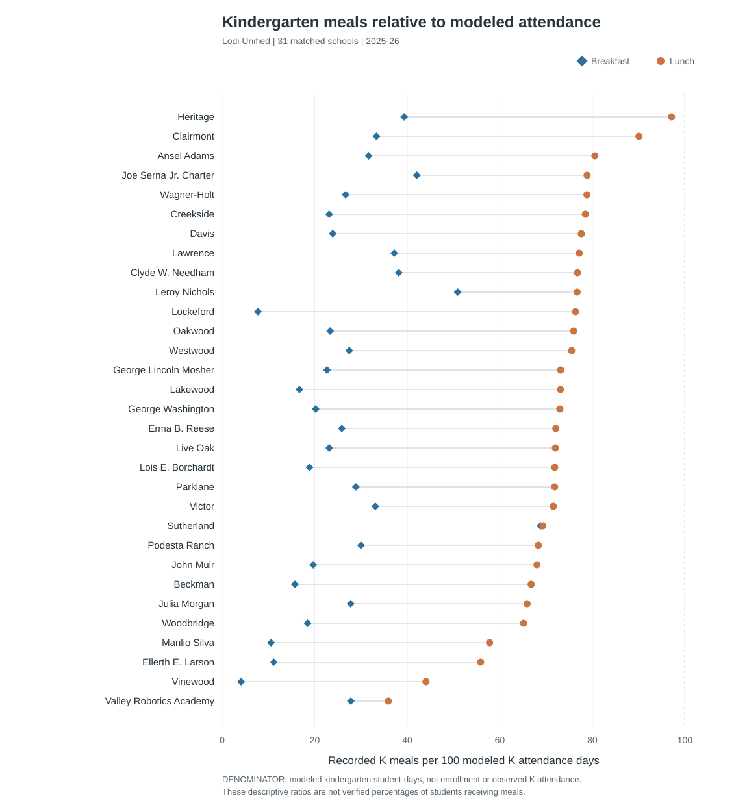

# Kindergarten meals and estimated attendance in Lodi Unified

**2025–26 school year · 31 matched schools · Draft for research-team review**

Lodi Unified’s meal workbook records **70,667 kindergarten breakfasts** and **203,639 kindergarten lunches** at the 31 schools in this comparison. We compare these meal counts with an estimate of the total days kindergarten students attended school. The meal counts come from the district; **the kindergarten attendance days are modeled from state data, not observed kindergarten attendance**.

| Measure across the 31 matched schools | Total |
| --- | ---: |
| Kindergarten breakfasts recorded | 70,667 meals |
| Kindergarten lunches recorded | 203,639 meals |
| **Estimated kindergarten student-days attended** | **287,174 days** |
| Breakfasts per 100 estimated K attendance days | 24.6 |
| Lunches per 100 estimated K attendance days | 70.9 |

These are **meal counts divided by modeled attendance days**, not percentages of students. For example, 70.9 lunches per 100 estimated attendance days does **not** establish that 70.9% of kindergarten children ate school lunch. The district-level ratios use total meals divided by total modeled days across all 31 schools, rather than averaging the individual school ratios.

## How we estimated attendance

We started with California Department of Education (CDE) Census Day kindergarten enrollment and the public count of absence days for **transitional kindergarten and kindergarten combined (TK/K)**. Because those absences are not reported separately for kindergarten, the model assigns a share to kindergarten according to kindergarten’s share of TK/K Census enrollment at each school. It assumes **180 school days**. The estimated kindergarten attendance days are the resulting modeled kindergarten average daily attendance multiplied by 180. This construction does not account directly for individual enrollment dates or observed kindergarten attendance days.

## How to read the school figure

Each school has one breakfast marker and one lunch marker. A marker farther right means a higher number of recorded meals for every 100 **estimated** kindergarten attendance days. The school ratios range from **4.1 to 68.8** for breakfast and **35.9 to 97.1** for lunch. These differences describe the records and estimates; they do not tell us why schools differ or which children received meals.

## Scope and questions

The district meal workbook and independent kindergarten eligibility report list the same 31 schools, all matched to the state attendance extract. Four additional state-file schools without corresponding meal records are excluded from **both** meal totals and attendance denominators here. The district workbook’s separate **Preschool** category is not treated as transitional kindergarten.

The main questions are whether the district’s kindergarten meal records cover the same service dates as the attendance construction, how kindergarten meals are classified, and how these estimates compare with actual kindergarten attended days if those become available. Until then, the figure is a descriptive comparison, **not a validated meal participation rate**.

**Sources:** Lodi Unified 2025–26 breakfast and lunch workbook; CDE 2025–26 Census enrollment and absenteeism records. Source versions and the full calculation are documented in the study [README](../README.md). *This draft has not been reviewed or approved by Lodi Unified.*